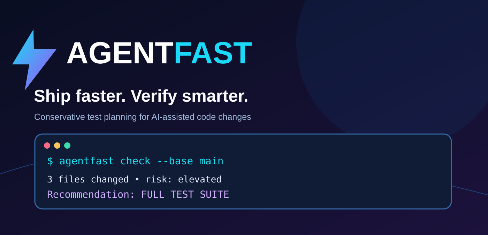
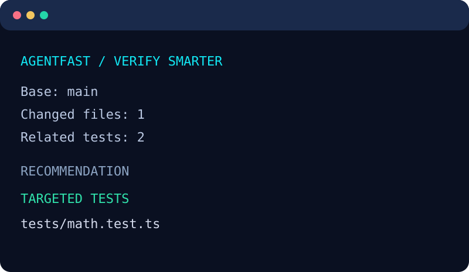
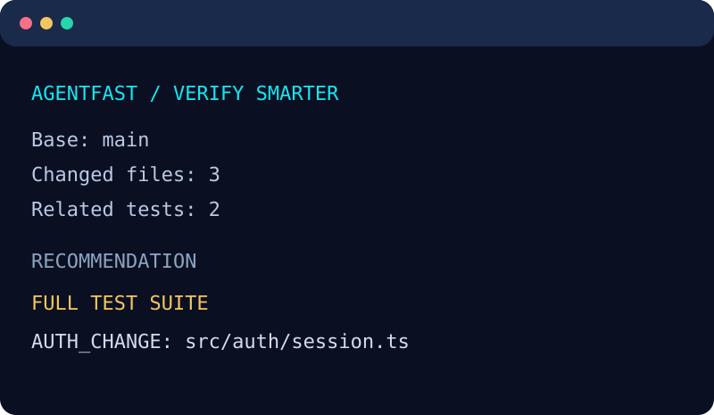
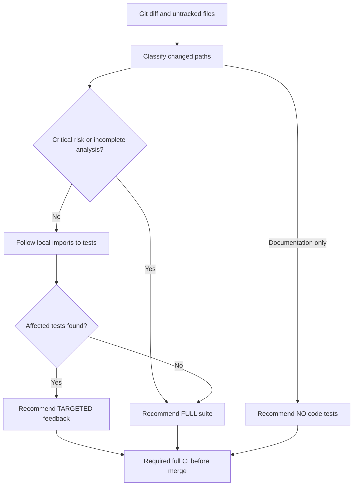

<div align="center">
  <a href="https://github.com/Brinkhagen/agentfast"></a>

  **Ship faster. Verify smarter.**  
  *Conservative, explainable test planning for AI-assisted code changes.*

  [](https://github.com/Brinkhagen/agentfast/actions/workflows/ci.yml)
  [](https://github.com/Brinkhagen/agentfast/actions/workflows/codeql.yml)
  [](LICENSE)
  [](package.json)
  [](package.json)
  [](https://github.com/Brinkhagen/agentfast/releases/latest)

  [Why AgentFast?](#why-agentfast) · [Install](#quick-start) · [How it works](#how-it-works) · [Safety policy](#safety-first) · [Contribute](CONTRIBUTING.md) · [Roadmap](docs/ROADMAP.md)
</div>

<p align="center"></p>
<p align="center"><sub>Conceptual brand illustration. The current CLI analyzes and recommends tests; it does not execute them automatically.</sub></p>

> **🧪 Beta testers wanted!** If you use coding agents or work with Node.js/TypeScript, please try the [10–15 minute beta test](docs/BETA-TESTING.md) and tell us what breaks. [Submit feedback](https://github.com/Brinkhagen/agentfast/issues/new?template=beta-feedback.yml). No API key, signup, or positive review required.

## Why AgentFast?

AI-assisted coding is fast. Verification can be slow or dangerously superficial. A small change may trigger every test, while a seemingly harmless file edit can affect authentication, billing, or a database migration.

**AgentFast gives developers an explicit, conservative recommendation before running tests:**

- 🔍 **Change-aware:** tracks committed-to-base, staged, unstaged, untracked, renamed, and deleted files.
- 🧭 **Explainable:** every decision includes a stable reason code and visible risk flags.
- ⚡ **Focused feedback:** traces literal local JavaScript/TypeScript imports and suggests affected test files when analysis is sufficiently simple.
- 🛡️ **Safe by default:** auth, payments, schema, config, structural, unresolved, and unknown changes require a full suite.
- 🔐 **Local-first:** zero runtime dependencies, no API key, no telemetry, no external source upload.
- 🤖 **Agent-friendly:** human-readable CLI output and machine-readable JSON for Codex, Claude Code, CI, or your own tools.

**AgentFast is not an alternative to a full CI suite, coverage analysis, or a security audit.** Its `targeted` result is an optimization hint for *development feedback*, not proof that a test suite is complete.

## Real CLI output

<table>
<tr><td width="50%"></td><td width="50%"></td></tr>
<tr><td align="center"><strong>Focused source change</strong></td><td align="center"><strong>Security-sensitive change</strong></td></tr>
</table>

Both visuals are styled presentations of output from `node examples/demo.mjs`; they are not synthetic performance benchmarks. Reproduce them locally.

## Quick start

> **Available now:** [AgentFast v0.1.0 is published on GitHub Releases](https://github.com/Brinkhagen/agentfast/releases/tag/v0.1.0), including an installable `.tgz` package. **It is not yet published to the npm registry.** Download the release asset or clone the source.

**Requirements:** Node.js 20+ and Git.

**Fast installation from the GitHub Release (without npm registry):**

```bash
npm install -g https://github.com/Brinkhagen/agentfast/releases/download/v0.1.0/brinkhagen-agentfast-0.1.0.tgz
agentfast --help
```

**Alternatively, install from source:**

```bash
git clone https://github.com/Brinkhagen/agentfast.git
cd agentfast
npm ci
npm run verify
npm link

# Switch to any existing Git project:
cd ../your-project
agentfast check --base HEAD
```

Without `npm link`, use an absolute path to the extracted CLI:

```bash
node /path/to/agentfast/bin/agentfast.js check --root /path/to/your-project --base HEAD
```

**Commands**

```bash
agentfast check --base origin/main       # Diff against a branch reference
agentfast check --json                   # Stable machine-readable advisory
agentfast check --fail-on-full           # Exit 2 when full tests are advised
agentfast doctor                         # Local environment and repository check
agentfast init                           # Create AGENTFAST.md workflow guide
agentfast --help
```

On a fresh checkout, ensure `origin/main` exists and you have fetched the base history before using it. Run a complete, independent CI test suite before merging or releasing.

### JSON example

```json
{
  "decision": {
    "mode": "full",
    "reason": "HIGH_RISK_CHANGE",
    "confidence": "heuristic"
  }
}
```

The excerpt above shows the `decision` field from the complete versioned schema (`schemaVersion: 1`). The full report also includes changed paths, risk reasons, candidate tests, and analysis diagnostics.

### CI usage

```yaml
- name: AgentFast risk advisory
  run: node ./bin/agentfast.js check --base origin/main --json

- name: Always run required tests
  run: npm test
```

You can use `--fail-on-full` to alert CI that a complete suite must run, but do **not** replace your existing tests with AgentFast's recommendations. The included GitHub Actions workflow independently runs the project's full test suite.

## How it works



**Risk categories included in v0.1:**

| Change type | Recommendation | Example reason |
| --- | --- | --- |
| Authentication / authorization | Full suite | `AUTH_CHANGE` |
| Checkout / payment / billing | Full suite | `PAYMENT_CHANGE` |
| Prisma schema or database migration | Full suite | `SCHEMA_CHANGE` |
| Package / runner / CI config | Full suite | `CONFIG_CHANGE` |
| Shared libraries | Full suite | `SHARED_CODE` |
| Unresolved import graph | Full suite | `INCOMPLETE_DEPENDENCY_GRAPH` |
| Ordinary source with related tests | Targeted feedback | `AFFECTED_TESTS_FOUND` |
| Only docs / images | No code tests suggested | `DOCUMENTATION_ONLY` |

See [architecture](docs/ARCHITECTURE.md) for precise limits. The current implementation recognizes local JS/TS imports, re-exports, literal dynamic imports, and CommonJS `require` heuristically; it does not resolve TypeScript alias maps or every bundler and workspace import.

## Why not just use Vitest `--changed`?

You should use it when it fits your workflow! Vitest has native `--changed` and experimental `--since-last-run` selection. AgentFast adds an **independent advisory risk policy layer**, a common JSON output, and conservative cross-project change classification. It is not claiming to outperform Vitest's own dependency tracking.

## Safety first

A fast result is not valuable if it overlooks a risky change. Therefore:

- Unknown import edges never grant a high-confidence targeted decision.
- Structural file changes require broad checks.
- Sensitive areas are classified by transparent path heuristics; this is not semantic vulnerability detection.
- Git arguments are passed without shell interpretation; repository source files are not evaluated.
- Project source remains on your machine. Network access is not needed for analysis.
- This pre-1.0 utility is experimental. Run complete protected CI gates before merging or deploying.

Read the [security policy](SECURITY.md).

## Open source, by BRINKHAGEN

AgentFast is maintained by [BRINKHAGEN](https://github.com/Brinkhagen). We welcome bug reports, test fixtures, docs improvements, and contributions that make recommendations safer and more useful.

- [Contributing guide](CONTRIBUTING.md)
- [Maintainers and project governance](MAINTAINERS.md)
- [Code of conduct](CODE_OF_CONDUCT.md)
- [Security policy](SECURITY.md)
- [Project roadmap](docs/ROADMAP.md)
- [Architecture and limitations](docs/ARCHITECTURE.md)
- [Release checklist](docs/RELEASE.md)
- [Brand assets](docs/BRAND.md)
- [Coding-agent integration](docs/AGENT-INTEGRATION.md)
- [Launch kit: Show HN, Reddit, DEV and social posts](docs/LAUNCH-KIT.md)
- [Community growth and adoption evidence](docs/GROWTH.md)
- [GitHub discoverability and recommended topics](docs/DISCOVERABILITY.md)

**License:** [MIT](LICENSE), © 2026 BRINKHAGEN UG (haftungsbeschränkt).  
**Disclaimer:** Independent community tooling. Not affiliated with or endorsed by OpenAI, Anthropic, GitHub, Vitest, Jest, or other vendors.

<div align="center"><sub>Ship faster. Verify smarter. — BRINKHAGEN Open Source</sub></div>